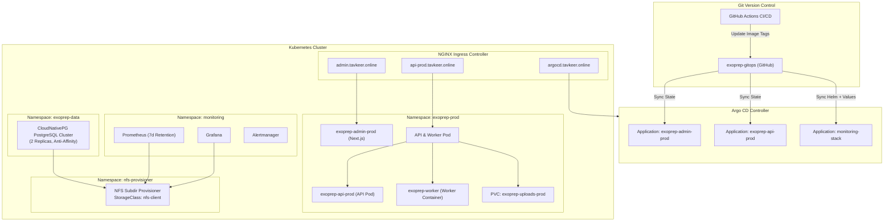

# ExoPrep GitOps

[](https://kubernetes.io/)
[](https://argoproj.github.io/cd/)
[](https://cloudnative-pg.io/)
[](https://prometheus.io/)
[](https://grafana.com/)

This repository is the central **GitOps and Infrastructure-as-Code (IaC)** source of truth for the **ExoPrep** platform. It manages automated continuous deployment, cluster storage, persistent databases, and full observability for production and platform services using **Argo CD** and **Kubernetes**.

---

## Table of Contents

- [System Architecture](#system-architecture)
- [Repository Structure](#repository-structure)
- [Core Components](#core-components)
  - [1. GitOps & Delivery (Argo CD)](#1-gitops--delivery-argo-cd)
  - [2. Production Applications (`exoprep-prod`)](#2-production-applications-exoprep-prod)
  - [3. Database Layer (`exoprep-data`)](#3-database-layer-exoprep-data)
  - [4. Storage Infrastructure (`nfs-provisioner`)](#4-storage-infrastructure-nfs-provisioner)
  - [5. Observability (`monitoring`)](#5-observability-monitoring)
- [Domains & Ingress Routing](#domains--ingress-routing)
- [GitOps Deployment Workflow](#gitops-deployment-workflow)
- [Secrets & Configuration Management](#secrets--configuration-management)
- [Setup & Operational Runbook](#setup--operational-runbook)

---

## System Architecture



---

## Repository Structure

```text
.
├── argocd/
│   ├── applications/                    # Declarative Argo CD Application manifests
│   │   ├── exoprep-admin-prod.yaml      # Admin frontend deployment application
│   │   ├── exoprep-api-prod.yaml        # API backend and background worker application
│   │   └── monitoring-stack.yaml        # Multi-source kube-prometheus-stack Helm app
│   └── ingress/
│       └── argocd-ingress.yaml          # Ingress routing for Argo CD web console
│
├── kubernetes/
│   ├── environments/
│   │   └── prod/                        # Production environment specifications
│   │       ├── namespace.yaml           # exoprep-prod namespace
│   │       ├── admin/                   # Admin portal (Next.js frontend)
│   │       │   ├── deployment.yaml      # 2-replica deployment mounting secrets
│   │       │   ├── service.yaml         # Internal ClusterIP service (port 3000)
│   │       │   └── ingress.yaml         # Ingress rules for admin.tavkeer.online
│   │       ├── api/                     # Backend API & Asynchronous Worker
│   │       │   ├── configmap.yaml       # Environment variables (CORS, MinIO, Redis, SMTP)
│   │       │   ├── deployment.yaml      # Multi-container pod (API + Worker)
│   │       │   ├── service.yaml         # ClusterIP service (port 4000)
│   │       │   ├── ingress.yaml         # Ingress rules for api-prod.tavkeer.online
│   │       │   └── storage.yaml         # Static PV & PVC for uploads (/data/k8s/uploads-prod)
│   │       └── data/
│   │           └── postgres/            # Database infrastructure
│   │               ├── namespace.yaml   # exoprep-data namespace
│   │               ├── cluster.yaml     # CloudNativePG 2-node HA PostgreSQL cluster
│   │               └── secrets.yaml     # Basic auth credentials template
│   │
│   ├── infrastructure/
│   │   └── nfs-provisioner/             # Dynamic persistent storage provider
│   │       ├── namespace.yaml           # nfs-provisioner namespace
│   │       ├── deployment.yaml          # sig-storage NFS subdir external provisioner
│   │       ├── rbac.yaml                # ClusterRoles, RoleBindings & ServiceAccounts
│   │       ├── storageclass.yaml        # StorageClass 'nfs-client' (reclaimPolicy: Retain)
│   │       └── test-pvc.yaml            # Diagnostic claim to verify dynamic provisioning
│   │
│   └── exoprep/                         # Base / standalone staging manifests
│       ├── configmap.yaml
│       ├── deployment.yaml
│       ├── ingress.yaml
│       ├── namespace.yaml
│       ├── service.yaml
│       ├── storage.yaml
│       └── gateway/                     # Kubernetes Gateway API definitions
│           ├── gateway.yaml
│           └── httproute.yaml
│
└── monitoring/
    └── kube-prometheus-stack/
        └── values.yaml                  # Custom Helm overrides for Prometheus, Alertmanager, Grafana
```

---

## Core Components

### 1. GitOps & Delivery (Argo CD)
All Kubernetes workloads in this cluster are declared as GitOps applications managed by **Argo CD**:
- **Continuous Synchronization**: Each application is configured with `automated` sync policies (`prune: true`, `selfHeal: true`). Any drift in the cluster is automatically reconciled against `main`.
- **Image Upgrades**: GitHub Actions workflows in application repositories automatically update image digests in this repository, triggering zero-downtime rolling deployments.

### 2. Production Applications (`exoprep-prod`)
- **API & Worker (`prod/api`)**:
  - Run together inside a multi-container Pod structure sharing network and volumes:
    - `api`: Node.js REST API service listening on port `4000`. Configured with HTTP liveness/readiness probes at `/health`.
    - `worker`: Queue consumer responsible for heavy background jobs, image transforms, and AI vision inference (via Groq `meta-llama/llama-4-scout-17b-16e-instruct`).
  - Storage: Both containers share an NFS-backed mount at `/app/uploads` using `exoprep-uploads-prod` claim backed by static PV `exoprep-uploads-prod-pv-v2`.
- **Admin Portal (`prod/admin`)**:
  - Scaled to 2 replicas running on port `3000`.
  - Serves administrative operations and dashboard views.

### 3. Database Layer (`exoprep-data`)
- Managed by the **CloudNativePG (CNPG)** operator.
- Deploys a production-grade 2-instance PostgreSQL cluster with:
  - Required pod anti-affinity across cluster nodes for high availability.
  - Automated primary/standby failover and streaming replication.
  - Dynamically provisioned 10Gi persistent volume backed by `nfs-client`.

### 4. Storage Infrastructure (`nfs-provisioner`)
- **NFS Subdir External Provisioner** connects to the primary storage node (`192.168.0.107`).
- Implements the `nfs-client` StorageClass:
  - **Dynamic Volume Provisioning**: Creates isolated subdirectories for each requested PVC under `/data/k8s/dynamic`.
  - **Data Safety**: Configured with `reclaimPolicy: Retain` and `archiveOnDelete: "true"` to prevent accidental data loss during pod or claim deletions.

### 5. Observability (`monitoring`)
- Managed through a multi-source Argo CD Application referencing the official `kube-prometheus-stack` Helm chart.
- **Prometheus**: Configured with a 7-day retention period and 8Gi persistent volume.
- **Grafana**: Pre-configured with persistent dashboard storage and custom credentials.
- **Alertmanager**: 2Gi volume claim for alert deduplication and routing.

---

## Domains & Ingress Routing

All traffic enters the cluster via the **NGINX Ingress Controller**:

| Service | Hostname | Internal Port | Ingress Features |
| :--- | :--- | :--- | :--- |
| **Argo CD** | `argocd.tavkeer.online` | 80 / 443 | SSL Termination, Web UI |
| **Admin Portal** | `admin.tavkeer.online` | 3000 | `50m` proxy body size upload limit |
| **Production API** | `api-prod.tavkeer.online` | 4000 | `50m` proxy body size, CORS headers |

---

## GitOps Deployment Workflow

```text
[Developer Push] ──> [GitHub Actions Build & Test] ──> [GHCR Container Registry]
                                                               │
                                                               ▼
[Cluster State] <── [Argo CD Auto-Sync] <── [Git Commit New Image Tag to main]
```

1. **Build & Release**: Code pushed to application repositories triggers automated container builds pushed to GitHub Container Registry (`ghcr.io/harudh/*`).
2. **GitOps Trigger**: The CI pipeline creates a commit on this repo's `main` branch updating the container image tag in `deployment.yaml`.
3. **Reconciliation**: Argo CD detects the git commit, compares cluster state with desired state, and triggers a Kubernetes `RollingUpdate` with 25% max surge / unavailable thresholds.

---

## Secrets & Configuration Management

> [!IMPORTANT]
> **Never commit raw production secrets or private keys directly to this repository.**
> Sensitive credentials must be injected into the cluster out-of-band via Kubernetes Secrets.

Workloads in `exoprep-prod` consume the following pre-created Kubernetes secrets:

1. **`ghcr-pull-secret`**:
   - Docker registry credentials (`kubernetes.io/dockerconfigjson`) to pull private container images from GitHub Container Registry.
2. **`exoprep-secret`**:
   - Environment variables (database passwords, tokens, API keys).
   - Secret key `serviceAccountKey.json` mounted into `/app/serviceAccountKey.json` for Firebase Admin SDK integration.
3. **`exoprep-postgres-app`** (in `exoprep-data`):
   - PostgreSQL authentication credentials.
4. **`grafana-admin-credentials`** (in `monitoring`):
   - Grafana dashboard admin username (`admin-user`) and password (`admin-password`).

---

## Setup & Operational Runbook

### Prerequisites
- Kubernetes cluster (v1.28+) with `kubectl` access
- NGINX Ingress Controller installed
- CloudNativePG Operator installed
- Argo CD installed in namespace `argocd`
- NFS Server accessible at `192.168.0.107`

### 1. Bootstrap Storage Provisioner
Ensure the NFS provisioner is active before scheduling stateful workloads:
```bash
kubectl apply -f kubernetes/infrastructure/nfs-provisioner/namespace.yaml
kubectl apply -f kubernetes/infrastructure/nfs-provisioner/rbac.yaml
kubectl apply -f kubernetes/infrastructure/nfs-provisioner/storageclass.yaml
kubectl apply -f kubernetes/infrastructure/nfs-provisioner/deployment.yaml
```

### 2. Provision Cluster Secrets
Create the required namespace and secrets:
```bash
kubectl create namespace exoprep-prod
kubectl create namespace exoprep-data

# GHCR pull secret
kubectl create secret docker-registry ghcr-pull-secret \
  --docker-server=ghcr.io \
  --docker-username=<GITHUB_USER> \
  --docker-password=<GITHUB_PAT> \
  -n exoprep-prod

# Application secret with Firebase service account
kubectl create secret generic exoprep-secret \
  --from-file=serviceAccountKey.json=/path/to/serviceAccountKey.json \
  -n exoprep-prod
```

### 3. Register Applications with Argo CD
Deploy the Argo CD application manifests:
```bash
kubectl apply -f argocd/applications/exoprep-api-prod.yaml
kubectl apply -f argocd/applications/exoprep-admin-prod.yaml
kubectl apply -f argocd/applications/monitoring-stack.yaml
```

### 4. Monitor Application Health
```bash
# Check Argo CD sync status
kubectl get applications -n argocd

# Inspect production workload status
kubectl get pods,pvc,ingress -n exoprep-prod

# Check PostgreSQL cluster health
kubectl get cluster.postgresql.cnpg.io -n exoprep-data
```

